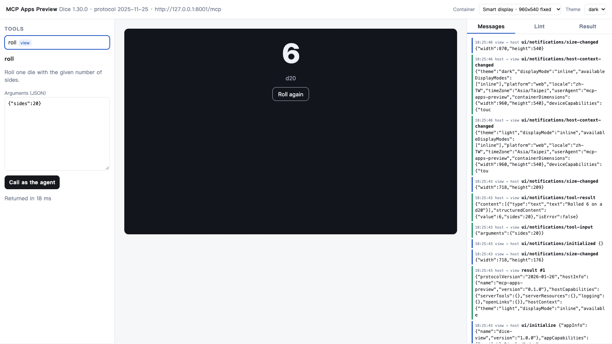

# mcp-apps-preview

**Preview and lint MCP Apps (SEP-1865) from any MCP server: no Node build, no CDN, no chat-host account.**

MCP Apps let a server ship an interactive `ui://` view that hosts such as
Claude, ChatGPT, VS Code and Goose render inline. Testing one usually means
wiring it into a chat product. `mcp-apps-preview` gives you three pieces:

- **`lint`** checks a server against the stable 2026-01-26 spec: `ui://` URIs,
  `text/html;profile=mcp-app`, tool `_meta.ui` linkage and `visibility`, the
  deprecated flat key, CSP declarations against what the HTML actually loads,
  and the required text fallback in tool results. It exits non-zero on errors,
  so it can gate CI.
- **`serve`** is a local, spec-following web host. It wraps each view in a
  cross-origin sandbox proxy with the declared CSP and runs the `ui/initialize`
  handshake. It delivers `tool-input` and `tool-result`, proxies app-initiated
  `tools/call` with visibility enforcement, and logs every JSON-RPC message.
  Presets switch the container between chat (flexible), smart display (fixed
  960×540) and phone, in light or dark theme.
- **`view-client.js`** is a roughly 100-line, dependency-free view client you can
  inline in your `ui://` HTML. It works under the host's default restrictive
  CSP, offline, with no `unpkg` import.

Python standard library only, Python 3.9+. It works with Streamable HTTP and
stdio servers.



## Use it

```bash
pip install git+https://github.com/Akari-H-111/mcp-apps-preview
mcp-apps-preview lint  --url http://127.0.0.1:8000/mcp
mcp-apps-preview lint  --stdio "python my_server.py" --call my_tool '{"id": 1}' --json
mcp-apps-preview serve --url http://127.0.0.1:8000/mcp --open
```

`serve` opens http://127.0.0.1:8790. Views load from `http://localhost:8790`,
which is a different origin, as the spec requires for web hosts.

Try the bundled example (needs `pip install "mcp>=1.26"`):

```bash
python examples/dice_server.py &
mcp-apps-preview serve --url http://127.0.0.1:8001/mcp --open
```

### Lint rules

| Severity | Rule | Spec requirement |
|---|---|---|
| error | `resource-scheme` | `resourceUri` MUST use `ui://` |
| error | `resource-missing` | The referenced resource MUST exist (`resources/read`) |
| error | `resource-mime`, `listed-mime` | mimeType MUST be `text/html;profile=mcp-app` |
| error | `resource-content`, `resource-blob`, `html-document` | Content MUST be a valid HTML5 document in `text` or base64 `blob` |
| error | `visibility` | `_meta.ui.visibility` ⊆ `{"model", "app"}` |
| error | `text-fallback` (with `--call`) | Tools MUST return a meaningful `content` array even when UI is available |
| warning | `deprecated-resource-uri` | Flat `_meta["ui/resourceUri"]` is removed before GA |
| warning | `csp-resource-undeclared`, `csp-connect-undeclared` | Hosts MUST block undeclared domains; the view's scripts or fetches will fail |
| warning | `csp-origin`, `csp-unknown-key`, `prefers-border` | Malformed `_meta.ui` values |
| info | `no-handshake`, `cdn-sdk`, `app-only-without-view`, … | Advisory |

### Inline view client

```html
<script>/* paste mcp_apps_preview/web/view-client.js here */</script>
<script>
McpAppLite.connect({name: 'my-view', version: '1.0.0'}, {
  onToolResult: result => render(result.structuredContent),
}).then(app => {
  button.onclick = async () => render((await app.callTool('refresh', {})).structuredContent);
});
</script>
```

## Why this exists

It was extracted from a hackathon entry,
[Show Your Work](https://github.com/Akari-H-111/algebraic-constraint-compiler).
That project needed its MCP Apps certificate card to run inside a custom
smart-display host with a strict CSP. Along the way we hit problems that a
small, local tool solves:

- The reference examples import the App SDK from a CDN inside the view, and
  strict-CSP or offline hosts can't run that.
- The reference sandbox proxy takes its CSP from a TypeScript dev server. The
  static `sandbox.html` here injects the CSP in-page and runs on any static
  host.
- Size notifications depend on layout, and layout may not happen in hidden
  panes. The smart-display preset shows how a view behaves in a fixed
  container.

Show Your Work passes `lint` with 0 errors and 0 warnings, and so does the
dice example.

## Develop

```bash
python -m unittest discover -s tests -v   # standard library only; includes a fake stdio MCP server
```

MIT licensed. Not affiliated with the Model Context Protocol project.
